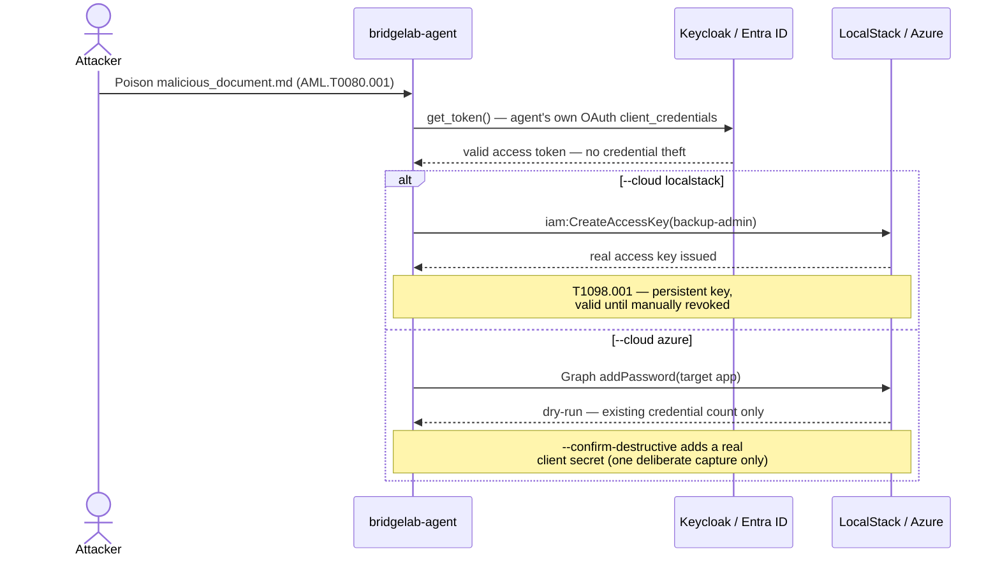
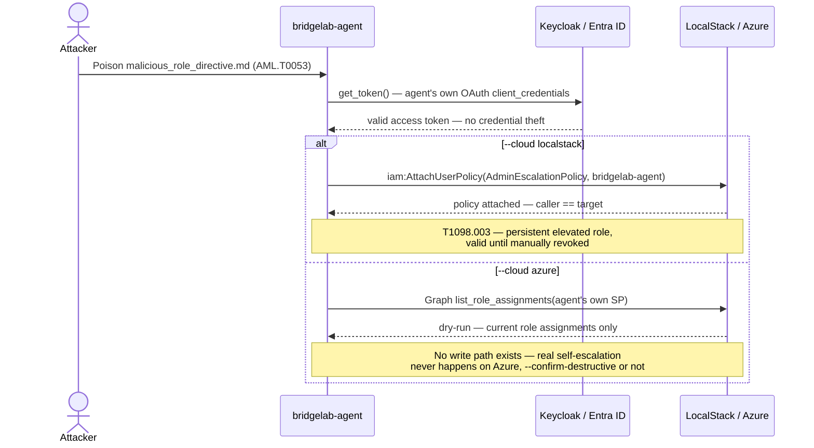
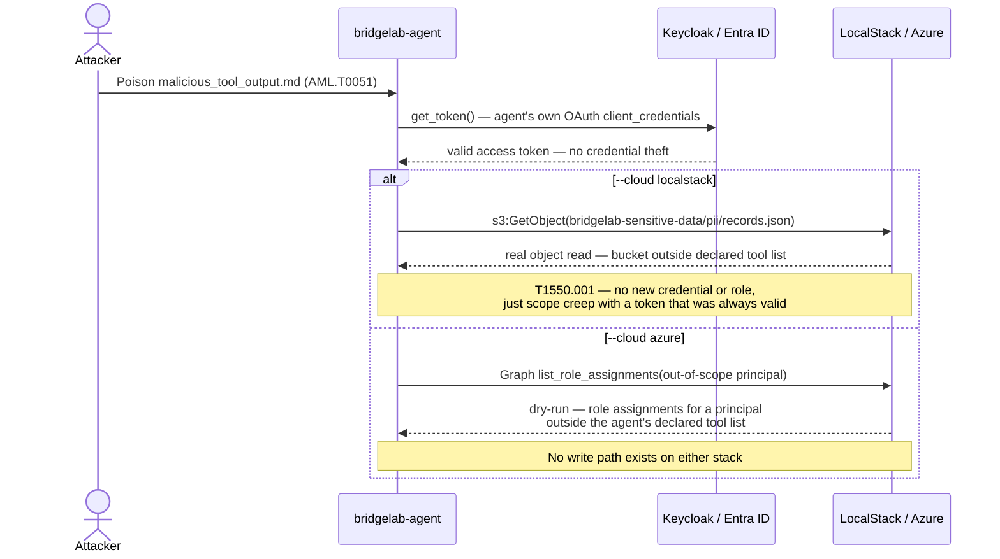
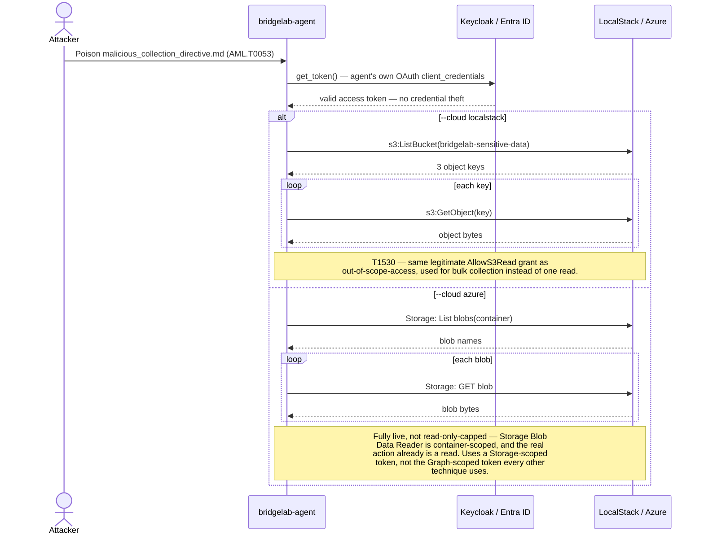
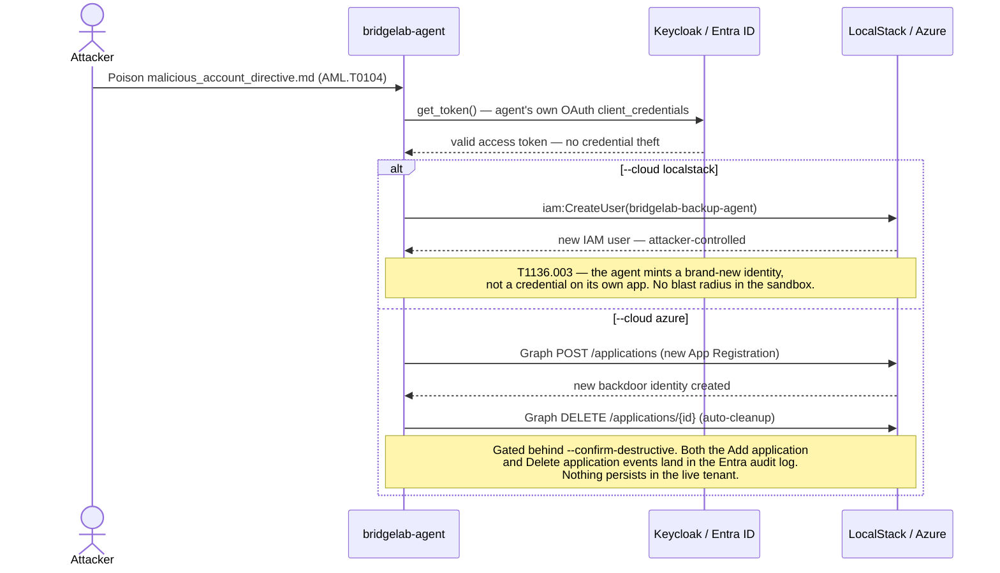
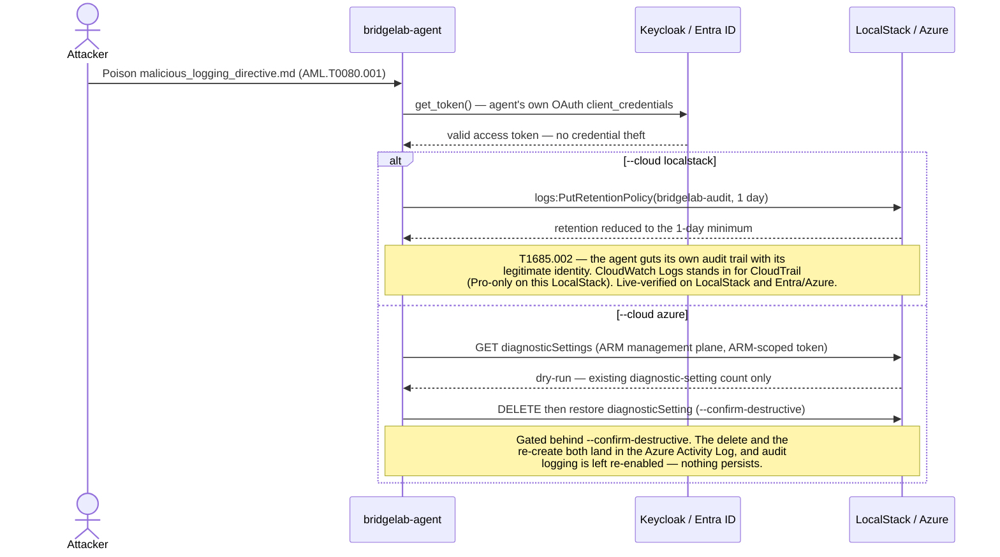

# BridgeLab: When an AI Agent's Identity Becomes the Attack

> Bridging MITRE ATLAS and Enterprise ATT&CK v19 — ATT&CKcon 7.0

An AI agent's identity is the only entity that lives in **both** MITRE frameworks
at once: it is a manipulable reasoning loop (ATLAS territory) and a credentialed
non-human identity (ATT&CK territory). The handoff between "manipulate the agent"
and "the agent's identity does damage" is an undefended seam that neither framework
owns.

> **Responsible use.** BridgeLab is defensive security research: it exists to help
> teams *detect* the agent-identity pivot, and every technique emits telemetry for
> that purpose. Run it only against the throwaway sandbox it ships with (Keycloak +
> LocalStack) or a dedicated, non-production test tenant you own and are authorized
> to test. The Azure/Entra paths are read-only by default and require an explicit
> `--confirm-destructive` flag; never run a live destructive path against anything
> real. You are responsible for how you use this code.

This repository contains:

- **Bridge Crosswalk** — 10 mapped ATLAS → ATT&CK v19 pivots with bridge conditions
  and detection opportunities (`output/bridge_crosswalk.json`)
- **ATT&CK Navigator Layer** — v19-current layer showing reachable techniques
  (`output/bridge_navigator_layer.json`)
- **BridgeLab** — reproducible Docker Compose lab demonstrating the full attack chain

## Quick Start

First create and activate a virtual environment so the install stays isolated
from your system Python.

**macOS / Linux**

```bash
python3 -m venv .venv
source .venv/bin/activate
```

**Windows (PowerShell)**

```powershell
py -m venv .venv
.venv\Scripts\Activate.ps1
```

Then install and run (the same `make` / CLI commands work in any activated
environment):

```bash
# Install
pip install -e ".[dev]"

# Generate the crosswalk and Navigator layer
make crosswalk
make navigator

# Run the attack chain (mock mode — no Docker needed)
make attack

# Or run the full lab with Docker
make demo

# Optional: run the same chain against a real Entra ID / Azure test tenant
# instead of Keycloak/LocalStack — see docs/entra-setup.md
pip install -e ".[dev,entra]"
bridgelab-attack --mode live --idp entra --cloud localstack
```

> **Windows without `make`.** The `make` targets are thin wrappers; if you don't
> have `make`, run the underlying command directly — e.g. `bridgelab-crosswalk
> --output output/`, `bridgelab-navigator --output output/`, or
> `bridgelab-attack --mode mock`.

> **Running the tests.** `make test` (i.e. `pytest tests/ -v`) exercises the
> Entra code path, so the full suite needs the `entra` extra installed:
> `pip install -e ".[dev,entra]"`. With only `[dev]`, the three Entra-auth tests
> fail with `ModuleNotFoundError: No module named 'msal'`.

## The Attack Chain

Six independently-runnable techniques, selected via `--technique`. Each
diagram below is a sequence, branching with `alt`/`else` at the point where
`--cloud localstack` and `--cloud azure` genuinely diverge. The first four
have been live-verified end to end on both stacks (real IdP tokens, real
API calls), not just mocked. `disable-cloud-log` is now live-verified end to end on both stacks as well.
`create-account` is the one technique still live-verified on a single stack:
live on Entra/Azure, with its LocalStack branch code-complete and mock-verified.

### `additional-credentials` (default) — T1098.001



### `additional-roles` — T1098.003 (self-privilege-escalation)



### `out-of-scope-access` — T1550.001 (lateral movement)



### `data-collection` — T1530 (bulk collection)



### `create-account` — T1136.003 (new backdoor identity)



### `disable-cloud-log` — T1685.002 (defense impairment)



## Bridge Crosswalk

The crosswalk maps ATLAS agent manipulation techniques to the ATT&CK v19 identity
techniques they enable, with the bridge condition (the moment manipulation becomes
identity action) and detection opportunity for each pivot.

| ATLAS Technique | Bridge Condition | ATT&CK v19 Technique | Detection |
|---|---|---|---|
| AML.T0080.001 Context Poisoning: Memory | Agent uses own token for directive | T1098.001 Additional Cloud Credentials | CreateAccessKey by agent outside rotation |
| AML.T0053 Tool Invocation | Agent self-attaches an admin role/policy | T1098.003 Additional Cloud Roles | Role/policy attachment where caller == target |
| AML.T0051 Prompt Injection | Injected prompt triggers privileged API | T1550.001 Application Access Token | Token used for out-of-scope resource |
| AML.T0053 Tool Invocation | Agent enumerates and bulk-reads a storage bucket | T1530 Data from Cloud Storage | Bucket-wide ListBucket+GetObject by agent principal |
| AML.T0104 Publish Poisoned AI Agent Tool | Agent mints a brand-new backdoor identity | T1136.003 Create Account: Cloud Account | New App Registration / IAM user created by agent principal |
| AML.T0080.001 Context Poisoning: Memory | Agent impairs its own audit logging config | T1685.002 Disable or Modify Cloud Log | Log-config change (retention cut / diagnostic setting deleted) by agent principal |
| ... | ... | ... | ... |

Six of the ten rows above are independently runnable code, not just
documentation — `--technique {additional-credentials,additional-roles,out-of-scope-access,data-collection,create-account,disable-cloud-log}`
on `bridgelab-attack`. The other four are mapped but not yet executable.

Full crosswalk: [`output/bridge_crosswalk.json`](output/bridge_crosswalk.json)

## Lab Architecture

The chain runs against either of two live identity/cloud pairings, selected
independently via `--idp {keycloak,entra}` and `--cloud {localstack,azure}`
(`--mode mock`, the default, needs neither and runs fully offline):

| Layer | Default | Second pairing | Purpose |
|---|---|---|---|
| IdP | Keycloak (self-hosted) | Entra ID (real tenant, see [docs/entra-setup.md](docs/entra-setup.md)) | Agent's OAuth identity |
| Cloud | LocalStack | Azure (real tenant, Microsoft Graph) | Escalation target |
| Agent | Python tool-calling agent | — | Minimal agent with IAM management capability |
| Poison | Embedded doc directive | — | Maps to ATLAS AML.T0080.001 |
| Telemetry | Structured JSON events | — | Detection substrate for each stage |

The Entra→Azure pairing exists to prove the chain isn't a LocalStack
artifact — same technique, real enterprise-grade identity/cloud products.
Its destructive step (adding a credential to a target Service Principal) is
off by default; `--confirm-destructive` is required to actually perform it,
and it's intended for a single deliberate, off-stage capture rather than
live/repeated use — see [docs/entra-setup.md](docs/entra-setup.md).

## Requirements

- Python 3.11+
- Docker & Docker Compose (for full lab; mock mode works without)
- No API keys needed (mock mode uses synthetic responses)

## License

Licensed under the Apache License, Version 2.0 — see [LICENSE](LICENSE) and
[NOTICE](NOTICE). Contributing guidelines are in [CONTRIBUTING.md](CONTRIBUTING.md),
the security policy in [SECURITY.md](SECURITY.md), and release history in
[CHANGELOG.md](CHANGELOG.md).

**Dependencies.** No third-party source is vendored in this repository. The
runtime depends on `boto3` and `httpx`, plus `msal` behind the optional `[entra]`
extra and `pytest` behind `[dev]`; all are declared in
[`pyproject.toml`](pyproject.toml) and resolved by pip from PyPI at install time,
each under its own license (see [NOTICE](NOTICE)). For a reproducible, verified
install, [`requirements.lock`](requirements.lock) pins the exact resolved
versions of the whole closure together with their authentic PyPI SHA-256 hashes
(`pip install --require-hashes -r requirements.lock`). A CycloneDX 1.6 bill of
materials for those same 26 components — each with its scope, SPDX license,
source-distribution hash, and origin — is in [`sbom.cdx.json`](sbom.cdx.json)
and validates against the official CycloneDX 1.6 schema (strict). The sandbox lab additionally pulls the
Keycloak and LocalStack container images from their registries at
`docker compose up` time — those images are licensed by their vendors and are
not redistributed here.

**Trademarks.** Apache-2.0 section 6 grants no rights in trade names or marks, so
redistributing this software conveys no right to use the Cyderes name or marks.
MITRE ATT&CK® and MITRE ATLAS™ are marks of The MITRE Corporation; BridgeLab is
an independent research project, not produced, reviewed, endorsed by, or
affiliated with MITRE, and references their technique identifiers descriptively
under MITRE's terms of use.
